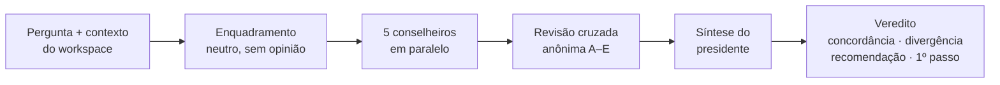

# llm-council

**Cinco lentes em tensão. Um veredito.**

Uma skill do Claude que passa qualquer decisão de alto custo de erro por um conselho de 5 conselheiros de IA — cada um pensando de um ângulo fundamentalmente diferente. Eles revisam o trabalho uns dos outros às cegas, e um presidente sintetiza tudo numa recomendação final. Um arquivo markdown. Sem servidor, sem dependência.

[Instalar](#instalar) · [Como funciona](#como-funciona) · [Quando usar](#quando-usar) · [Exemplo](#exemplo) · [FAQ](#faq) · [Página](https://llm-council-page.vercel.app)

---

Você pergunta pra uma IA, recebe uma resposta. Pode ser ótima. Pode ser mais ou menos. Você não tem como saber — só viu uma perspectiva.

O método é adaptado do **LLM Council** de **Andrej Karpathy**: dispara a pergunta pra vários modelos, faz cada um revisar os outros de forma anônima, e um presidente produz a resposta final. Aqui isso roda dentro do Claude, usando sub-agentes com lentes de pensamento diferentes no lugar de modelos diferentes.

Feito pra quem decide sob incerteza genuína — pricing, posicionamento, pivô, contratação — e precisa pressionar a decisão de vários ângulos antes de se comprometer.

## O problema

Uma resposta de IA chega com confiança, mas é um ângulo só: o que o modelo achou mais provável dado o jeito que você perguntou. O que ela deixou de fora você não vê, porque ela também não viu.

Perguntar a mesma coisa cinco vezes não resolve — você recebe cinco variações do mesmo centro. Falta tensão entre ângulos genuinamente diferentes, e falta alguém conferindo o trabalho dos outros. É isso que a revisão cruzada anônima resolve.

## Como funciona



A skill enquadra a pergunta de forma neutra, convoca os 5 conselheiros em paralelo, embaralha as respostas em A–E pra revisão cruzada anônima, e fecha com o veredito do presidente. Entrega um relatório HTML + a transcrição completa.

**Os cinco conselheiros** — lentes que entram em tensão de propósito:

| Conselheiro | A lente |
|-------------|---------|
| **O Contrário** | procura a falha fatal — assume que a ideia tem um defeito que a mata e vai atrás dele |
| **O Pensador de Primeiros Princípios** | tira as premissas e remonta o problema do zero; às vezes responde "você está fazendo a pergunta errada" |
| **O Expansionista** | caça o upside esquecido — o que poderia ser maior, que oportunidade adjacente está escondida |
| **O Forasteiro** | zero contexto, zero ponto cego — pega o que é óbvio pra você e confuso pra todo mundo |
| **O Executor** | "tá, e segunda de manhã?" — dá pra fazer, e qual o caminho mais rápido |

O passo que faz o conselho ser mais que "perguntar 5 vezes" é a **revisão cruzada anônima**: cada conselheiro vê as respostas embaralhadas e aponta a mais forte, o maior ponto cego e o que todas deixaram passar. É aí que o ponto cego aparece.

## Quando usar

**Convoque o conselho quando:**
- A decisão tem trade-off real e o custo de errar é alto
- Você está dividido entre opções (X ou Y) e o caminho não é óbvio
- Você quer pressionar uma ideia de vários ângulos antes de se comprometer
- Pricing, posicionamento, pivô, contratação, validação de oferta

**Não convoque quando:**
- A pergunta tem uma resposta certa ("qual a capital da França?") → só responda
- É tarefa de criação (escrever um tweet) ou de processamento (resumir um artigo)
- É "devo" casual sem trade-off de peso ("devo usar markdown?")

O conselho brilha na incerteza genuína. Se você já sabe a resposta e só quer validação, ele provavelmente vai te dizer coisas que você não quer ouvir. É exatamente esse o ponto.

## Exemplo

Brief: *"Passa no conselho: tô pensando em construir um curso de R$897 sobre Claude Code pra iniciantes. Minha audiência é majoritariamente solopreneur não-técnico. É a jogada certa?"*

Os cinco divergem com força: o Contrário aponta a concorrência do conteúdo grátis; o Expansionista vê um mercado enorme e mal atendido; o Executor manda validar com um workshop de R$197 antes de produzir nada. Mas o insight decisivo vem da revisão cruzada: todos, menos o Forasteiro, assumiram que a audiência sabe o que é "Claude Code".

Veredito do presidente: não construa o curso ainda; reenquadre por completo e venda o resultado, não a ferramenta. Primeiro passo: um workshop ao vivo de R$197 chamado "Como automatizar sua primeira tarefa de negócio com IA" — sem citar a ferramenta no título.

Método completo em [`skills/llm-council/SKILL.md`](./skills/llm-council/SKILL.md) e no [método canônico](./skills/llm-council/references/metodo-canonico.md).

## Instalar

```bash
# Via skills CLI (recomendado)
npx skills add 1marcelserrano/llm-council

# Ou manualmente — faça backup antes se a pasta já existir:
# mv ~/.claude/skills/llm-council ~/.claude/skills/llm-council.backup
git clone https://github.com/1marcelserrano/llm-council.git
cp -r llm-council/skills/llm-council ~/.claude/skills/
```

**Verifique:** abra uma sessão nova do Claude e rode `/skills` (ou pergunte "que skills você tem?"). `llm-council` deve aparecer. Se não, confira que `~/.claude/skills/llm-council/SKILL.md` existe e reinicie a sessão.

**Sem terminal?** Baixe [`llm-council.skill`](./llm-council.skill) e suba no Claude (Cowork / claude.ai → Skills).

## FAQ

**Precisa de API key, conta paga ou servidor?** Não. É um arquivo markdown que o Claude carrega. Roda onde o Claude roda.

**Funciona sem sub-agentes?** Sim. Se o ambiente não tem sub-agentes, a skill roda cada conselheiro inline, como passos analíticos independentes. O resultado é o mesmo; só a orquestração muda.

**Por que anonimizar a revisão cruzada?** Se os revisores sabem quem disse o quê, deferem a certos estilos em vez de avaliar pelo mérito. O anonimato força o julgamento pela qualidade do argumento.

**O presidente sempre segue a maioria?** Não. Se 4 de 5 dizem "faz" mas o raciocínio do único dissidente é o mais forte, o presidente fica com o dissidente e explica por quê.

**É a mesma coisa que pedir "me dá várias perspectivas"?** Não. Sem lentes em tensão e sem revisão cruzada, você recebe variações do mesmo centro. O mecanismo é o conselho + o peer review anônimo.

---

Uma skill do **[MSCREATIVE.SYSTEMS™](https://fronteirista.substack.com)**. Método: LLM Council, de Andrej Karpathy. Licença MIT — use, modifique, redistribua. Mantenha os créditos.
